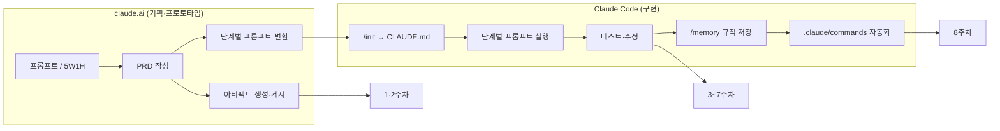

# AI-Application-Practice · 인공지능활용실습 1~8주차

국립목포대학교 「인공지능활용실습」 과목에서 Claude(claude.ai)와 Claude Code로 진행한 바이브 코딩 실습 결과물입니다.
**주차마다 실행 방법, 구현 기능, 채점 확인 포인트**를 정리했습니다. 각 주차 폴더는 독립적으로 실행됩니다.

## 제출자 정보

| 항목 | 내용 |
|---|---|
| 이름 | 서승하 |
| 학번 | 243441 |
| 학과 / 학년 | 컴퓨터공학과 / 3학년 |
| GitHub 아이디 | [racoon809](https://github.com/racoon809) |
| 저장소 주소 | https://github.com/racoon809/AI-Application-Practice |
| 웹 배포 주소 | https://racoon809.github.io/AI-Application-Practice/ |
| 제출일 | 2026-10-28 |

## 목차
- [한눈에 보기](#한눈에-보기)
- [1주차 · 나만의 시작 홈페이지](#1주차--나만의-시작-홈페이지)
- [2주차 · 마케팅 포트폴리오](#2주차--마케팅-포트폴리오)
- [3주차 · 손글씨 숫자 인식](#3주차--손글씨-숫자-인식)
- [4주차 · 할 일 관리 앱](#4주차--할-일-관리-앱)
- [5주차 · 자동 카테고리 분류](#5주차--자동-카테고리-분류)
- [6주차 · 데스크톱 레이아웃](#6주차--데스크톱-레이아웃)
- [7주차 · 상식 퀴즈와 할루시네이션 방지](#7주차--상식-퀴즈와-할루시네이션-방지)
- [8주차 · 커스텀 명령어 자동화](#8주차--커스텀-명령어-자동화)
- [테스트](#테스트)
- [데이터 저장 방식 (채점 가이드)](#데이터-저장-방식-채점-가이드)
- [GitHub Pages 배포와 유의 사항](#github-pages-배포와-유의-사항)
- [채점자를 위한 최종 제출 체크리스트 및 실행 안내](#채점자를-위한-최종-제출-체크리스트-및-실행-안내)

---

## 한눈에 보기

폴더 이름은 `WeekNN-주제` 규칙을 따르며, 앞의 번호가 곧 주차입니다. 하나의 앱을 두 주에 걸쳐 확장한 실습(5~6주차, 7~8주차)은 `Week05-06`처럼 두 주차를 함께 적었습니다.

| 주차 | 실습 | 폴더 | 바로 실행 (GitHub Pages) | 필요 환경 |
|---|---|---|---|---|
| 1 | 나만의 시작 홈페이지 | [Week01-StartPage](Week01-StartPage/) | [열기](https://racoon809.github.io/AI-Application-Practice/Week01-StartPage/) | 브라우저 |
| 2 | 마케팅 포트폴리오 | [Week02-Portfolio](Week02-Portfolio/) | [열기](https://racoon809.github.io/AI-Application-Practice/Week02-Portfolio/) | 브라우저 |
| 3 | 손글씨 숫자 인식 | [Week03-DigitRecognition](Week03-DigitRecognition/) | [웹 버전](https://racoon809.github.io/AI-Application-Practice/Week03-DigitRecognition/web_version/) | Python 3.10+ / 브라우저 |
| 4 | 할 일 관리 앱 | [Week04-TodoApp](Week04-TodoApp/) | [열기](https://racoon809.github.io/AI-Application-Practice/Week04-TodoApp/) | 브라우저 |
| 5 | 자동 카테고리 분류 | [Week05-06-SmartTodo/week05](Week05-06-SmartTodo/week05/) | [열기](https://racoon809.github.io/AI-Application-Practice/Week05-06-SmartTodo/week05/) | 브라우저 |
| 6 | 데스크톱 레이아웃 | [Week05-06-SmartTodo/week06](Week05-06-SmartTodo/week06/) | [열기](https://racoon809.github.io/AI-Application-Practice/Week05-06-SmartTodo/week06/) | 브라우저 |
| 7 | 상식 퀴즈 + 검증 가이드라인 | [Week07-08-QuizGame](Week07-08-QuizGame/) | [열기](https://racoon809.github.io/AI-Application-Practice/Week07-08-QuizGame/) | 브라우저 |
| 8 | 커스텀 명령어 | [Week07-08-QuizGame/.claude/commands](Week07-08-QuizGame/.claude/commands/) | Claude Code에서 `/quiz-validate` | Claude Code |

- 웹 실습은 HTML·CSS·JavaScript만 사용합니다. **설치·빌드·서버가 필요 없고**, `index.html`을 더블 클릭하면 실행됩니다. (Chrome·Edge 권장)
- Python은 3주차에만 필요합니다.

```
AI-Application-Practice/
├── README.md · GITHUB_GUIDE.md · .gitignore · .gitattributes · .nojekyll
├── Week01-StartPage/          1주차  index.html (단일 파일)
├── Week02-Portfolio/          2주차  PRD.md · index.html · style.css
├── Week03-DigitRecognition/   3주차
│   ├── desktop_version/          Tkinter 앱 (preprocess · model · gui 모듈) + tests/
│   ├── web_version/              Canvas 웹 앱 + 학습된 가중치 model.js
│   └── tests/                    데스크톱 ↔ 웹 전처리 일치 테스트
├── Week04-TodoApp/            4주차  할 일 관리 앱 (제출 원본)
├── Week05-06-SmartTodo/       5~6주차
│   ├── core.js                   두 화면 공통 로직 (자동 분류 포함)
│   ├── week05/                   5주차 모바일 화면 + ui.js
│   ├── week06/                   6주차 데스크톱 화면 + ui.js
│   └── tests/                    자동 분류 테스트 (node --test)
└── Week07-08-QuizGame/        7~8주차  퀴즈 게임
    └── .claude/commands/         8주차 커스텀 명령어 3개
```

### 작업 흐름



---

## 1주차 · 나만의 시작 홈페이지
**폴더** [Week01-StartPage](Week01-StartPage/) · **배운 것** 아티팩트, 프롬프트, 게시, 커스터마이즈

| 실행 | 방법 |
|---|---|
| 로컬 | `Week01-StartPage/index.html` 더블 클릭 |
| GitHub Pages | https://racoon809.github.io/AI-Application-Practice/Week01-StartPage/ |
| Claude 아티팩트 | https://claude.ai/artifact/4evmxAcH7cLU5dCWqq8QWw |

**기능** 실시간 시계·날짜 · 구글 검색바(새 탭) · 지역별 날씨와 4일 예보(Open-Meteo) · 기술 뉴스 6개(Hacker News) · 오늘의 할 일 · 메모지 2열 배치 · 다크 모드

**확인 포인트**
- 검색어 입력 후 Enter → 구글 검색 결과가 새 탭으로 열림
- 지역을 목포로 바꾸면 날씨가 바뀜 (아티팩트 안에서는 외부 요청이 막혀 '예시 데이터' 표시)
- 창 폭을 줄이면 메모지가 1열로 정리됨

## 2주차 · 마케팅 포트폴리오
**폴더** [Week02-Portfolio](Week02-Portfolio/) · **배운 것** 5W1H, PRD, 뼈대→기능→디자인→점검 4단계 전략

| 실행 | 방법 |
|---|---|
| 로컬 | `Week02-Portfolio/index.html` 더블 클릭 |
| GitHub Pages | https://racoon809.github.io/AI-Application-Practice/Week02-Portfolio/ |
| Claude 아티팩트 | https://claude.ai/artifact/Lkdq7n5qtsNyY6HBGiTiC1 |

**결과물** [PRD.md](Week02-Portfolio/PRD.md)(5W1H 기획서) + `index.html`(PRD의 9개 섹션 ID를 그대로 구현)
**기능** 고정 내비게이션 · Before/After 차트 · 3년 성과 타임라인 · 숙련도 막대 · 케이스 분야 필터 · 연락처 복사 · 문의 폼 검증 · 섹션별 색상 톤 · 다크 모드

**확인 포인트** 상단 메뉴를 누르면 해당 섹션으로 이동 · 케이스 필터 동작 · 단계별 프롬프트 기록은 [README](Week02-Portfolio/README.md)

## 3주차 · 손글씨 숫자 인식
**폴더** [Week03-DigitRecognition](Week03-DigitRecognition/) · **배운 것** Claude Code 설치, `/init`, `CLAUDE.md`, `#` 메모리, 계층형 CLAUDE.md

마우스로 그린 0~9 숫자를 MNIST로 학습한 신경망(784→128→10)이 인식해 예측 숫자, 신뢰도, 숫자별 확률을 보여 줍니다.

**두 방식을 함께 쓰는 이유:** 데스크톱은 NumPy·Pillow만으로 실행되도록 신경망을 직접 구현했고, 웹은 설치·서버 없이 브라우저에서 바로 예측하도록 scikit-learn으로 학습한 가중치를 `model.js`로 내보냈습니다. 두 버전이 같은 28×28 입력을 만드는지는 [`tests/test_parity.py`](Week03-DigitRecognition/tests/test_parity.py)가 자동으로 확인합니다.

### 준비
Python **3.10 이상** 설치 (설치 화면에서 **Add python.exe to PATH** 체크) → 명령 프롬프트에서 `python --version` 확인

### 데스크톱 버전 (`Week03-DigitRecognition/desktop_version`, Tkinter + NumPy)
| 방법 | 실행 |
|---|---|
| 배치 파일 | ① `install_requirements.bat` 더블 클릭(처음 한 번) → ② `run_digit_recognition.bat` 더블 클릭 |
| 명령어 | `cd Week03-DigitRecognition` → `pip install -r requirements.txt` → `cd desktop_version` → `python digit_recognition.py` |
| 테스트 | `cd Week03-DigitRecognition` → `python -m pytest -q` |

- 처음 실행하면 MNIST를 내려받아 학습한 뒤 창이 열립니다. 이후에는 저장된 가중치로 바로 열립니다.
- `run_digit_recognition.bat`은 라이브러리가 없으면 `install_requirements.bat`을 자동 호출하고, `python`이 없으면 `py -3`를 찾습니다.
- 옵션: `--retrain`(다시 학습), `--epochs 15`(학습 횟수)
- 코드는 책임별로 나뉘어 있습니다: `preprocess.py`(획 → 28×28) · `model.py`(신경망·학습) · `gui.py`(Tkinter 화면) · `digit_recognition.py`(실행 진입점)

### 웹 버전 (`Week03-DigitRecognition/web_version`, Canvas + JavaScript)
| 방법 | 실행 |
|---|---|
| 서버 없이 | `index.html` 더블 클릭 — `model.js`의 학습된 가중치로 바로 예측, GitHub Pages에서도 동작 |
| 배치 파일 | `run_web_server.bat` 더블 클릭 — 라이브러리 자동 설치 → `http://localhost:8000` 자동으로 열림 |
| 명령어 | `cd Week03-DigitRecognition\web_version` → `pip install -r requirements.txt` → `python server.py` (`--port 5000`으로 포트 변경) |
| 정적 서버 | `cd Week03-DigitRecognition\web_version` → `python -m http.server 8000` — 라이브러리 없이 `model.js`로 예측 |

**확인 포인트** 숫자를 그리면 획마다 예측 갱신 · **[Recognize]**(`Enter`) / **[Clear]**(`Esc`) · 자세한 내용 [Week03-DigitRecognition/README.md](Week03-DigitRecognition/README.md) · 실행이 안 되면 [TROUBLESHOOTING.md](Week03-DigitRecognition/TROUBLESHOOTING.md)

## 4주차 · 할 일 관리 앱
**폴더** [Week04-TodoApp](Week04-TodoApp/) · **배운 것** 단계별 프롬프트 전략, `/status`, `/model`, `/help`

| 실행 | 방법 |
|---|---|
| 로컬 | `Week04-TodoApp/index.html` 더블 클릭 |
| GitHub Pages | https://racoon809.github.io/AI-Application-Practice/Week04-TodoApp/ |

PRD를 5단계 프롬프트로 나눠 Claude Code에서 순서대로 구현했습니다.

| 단계 | 기능 |
|---|---|
| 1 | 할 일 추가·완료·삭제, 저장 |
| 2 | 업무/개인/공부 카테고리, 우선순위, 필터 |
| 3 | 전체·카테고리별 진행률 대시보드, 더블 클릭 수정 |
| 4 | 다크 모드, 완료 항목 일괄 삭제, 단축키, 삭제 실행 취소 |
| 5 | 정렬 6종(드래그 직접 정렬 포함), 오늘의 명언, JSON 내보내기/가져오기 |

**새로고침해도 등록한 일정이 그대로 남습니다.** 추가·수정·완료할 때마다 브라우저에 저장하고, 페이지를 열 때 다시 불러옵니다. 새로고침 때 비워지는 것은 '새 일정' 입력 폼뿐입니다. → [데이터 저장 방식](#데이터-저장-방식-채점-가이드)

**확인 포인트** 일정 2~3개 추가 → 하나 완료 체크 → `F5` → 목록과 체크가 유지되고 입력창만 비어 있음 · 단축키 `Alt+N` 새 일정, `Alt+D` 테마, `Alt+1~4` 필터 · 자세한 내용 [Week04-TodoApp/README.md](Week04-TodoApp/README.md)

## 5주차 · 자동 카테고리 분류
**폴더** [Week05-06-SmartTodo/week05](Week05-06-SmartTodo/week05/) · **배운 것** `claude --resume`, `-c`, Shift+Tab 자동 승인, `/context`, `/compact`

| 실행 | 방법 |
|---|---|
| 로컬 | `Week05-06-SmartTodo/week05/index.html` 더블 클릭 |
| GitHub Pages | https://racoon809.github.io/AI-Application-Practice/Week05-06-SmartTodo/week05/ |

할 일 문장의 단어를 카테고리별 키워드 사전과 비교해 점수가 가장 높은 카테고리를 추천합니다. (코드: [core.js](Week05-06-SmartTodo/core.js)의 `[5주차]` 블록)

| 기능 | 동작 |
|---|---|
| 스마트 키워드 분석 | 입력하는 동안 추천 카테고리와 근거 키워드 표시 |
| 자동 분류 | 고른 카테고리와 추천이 다르면 확인 창 |
| 자동 재분류 | 기존 항목 중 바뀔 것만 골라 일괄 적용 |
| 분류 설정 | 켜기/끄기, 확인 후 적용/바로 적용, 카테고리별 내 키워드 추가 |

**확인 포인트** (아래 입력은 [tests/core.test.js](Week05-06-SmartTodo/tests/core.test.js)에서도 자동 검사)
| 입력 | 고른 카테고리 | 결과 |
|---|---|---|
| 내일 회사 스케줄 확인 | 개인 | 업무 추천 (회사, 스케줄) |
| 영화 보러 가기 | 업무 | 개인 추천 (영화) |
| 중간고사 공부 | 개인 | 공부 추천 |

## 6주차 · 데스크톱 레이아웃
**폴더** [Week05-06-SmartTodo/week06](Week05-06-SmartTodo/week06/) · **배운 것** 이미지 입력, `@` 파일 참조, `/config`, `/doctor`, `/export`

| 실행 | 방법 |
|---|---|
| 로컬 | `Week05-06-SmartTodo/week06/index.html` 더블 클릭 (1280px 이상 창 권장) |
| GitHub Pages | https://racoon809.github.io/AI-Application-Practice/Week05-06-SmartTodo/week06/ |

앱 화면 캡처를 Claude Code에 넣어 데스크톱 전체 화면용으로 바꾸도록 요청했습니다.
**기능** 사이드바(진행률 링·보기/카테고리 필터·분류·데이터 도구·다크 모드) | 할 일 목록 | 대시보드(카테고리 진행률·격언) 3단 · 화면 폭에 따라 2단·1단 자동 전환 · 5주차 자동 분류 그대로 사용

**코드 구조** 5주차와 6주차 화면은 공통 로직 [`core.js`](Week05-06-SmartTodo/core.js) 하나를 함께 쓰고, 화면마다 다른 부분(진행률 막대 / 진행률 링·목록 제목)만 각 폴더의 `ui.js`에 있습니다. 같은 파일을 두 번 복사하지 않으므로 기능을 고칠 때 한 곳만 바꾸면 됩니다.

**확인 포인트** 창 폭을 1440 → 1100 → 400px로 줄이며 레이아웃 전환 확인 · 5주차와 같은 데이터를 공유 (한쪽에서 추가한 할 일이 다른 쪽에도 보임)

## 7주차 · 상식 퀴즈와 할루시네이션 방지
**폴더** [Week07-08-QuizGame](Week07-08-QuizGame/) · **배운 것** `/memory`, `/clear`, 프로젝트 메모리

| 실행 | 방법 |
|---|---|
| 로컬 | `Week07-08-QuizGame/index.html` 더블 클릭 → 이름 입력 → 모드 선택 → **[게임 시작]** |
| GitHub Pages | https://racoon809.github.io/AI-Application-Practice/Week07-08-QuizGame/ |

**기능** 한국사·과학·지리·일반상식 40문제(분야별 10) · 보기 클릭 또는 키보드 `1`~`4` · 정답/오답과 해설 즉시 표시 · 최종 점수·정답률·분야별 결과 · TOP 10 순위

**할루시네이션 방지** [CLAUDE.md](Week07-08-QuizGame/CLAUDE.md)에 「퀴즈 문제 교차 검증 가이드라인」(정답 유일성 · 최상급 표현의 측정 기준 · 시점과 범위 · 교차 검증)을 저장하고, `/clear` 후 이 규칙만으로 전체 문제를 다시 점검했습니다.
- 예) 「**전통적 측정 기준으로** 세계에서 가장 긴 강은?」 → 나일강, 해설에 아마존강 논쟁 안내
- 문제마다 `basis` 필드에 적용한 기준을 기록 ([quiz-data.js](Week07-08-QuizGame/quiz-data.js))
- 정답 위치를 ①②③④에 10개씩 고르게 배치

## 8주차 · 커스텀 명령어 자동화
**폴더** [Week07-08-QuizGame/.claude/commands](Week07-08-QuizGame/.claude/commands/) · **배운 것** `.claude/commands`, `$ARGUMENTS`, `$1` `$2`

**게임 확장** 클래식(40문제) · 스피드 퀴즈(무작위 20문제, 15초, 남은 초 보너스, 힌트 -5점) · 카테고리 도전(10문제)

**커스텀 명령어** — `Week07-08-QuizGame` 폴더에서 `claude` 실행 후 사용
| 명령어 | 하는 일 |
|---|---|
| `/quiz-validate [카테고리]` | 최상급·모호한 표현을 찾아 기준 명시 여부 판정 (생략 시 전체) |
| `/quiz-range 1 20` | 1~20번의 난이도·정답 위치·카테고리 분포 분석 |
| `/quiz-add 한국사 medium` | 가이드라인을 지킨 새 문제를 미리보기 후 추가 |

명령어 파일을 새로 만들거나 고친 뒤에는 `/exit` → `claude`로 다시 시작해야 목록에 나타납니다. 자세한 내용 [Week07-08-QuizGame/README.md](Week07-08-QuizGame/README.md)

---

## 테스트

| 주차 | 실행 위치 | 명령 | 테스트 | 내용 |
|---|---|---|---|---|
| 3 | `Week03-DigitRecognition` | `python -m pytest -q` | 43 + 7 | 전처리·신경망 43개 (tkinter 없는 환경에서도 실행) + 데스크톱 ↔ 웹 전처리 일치 7개 |
| 5·6 | `Week05-06-SmartTodo` | `node --test` | 9 | 자동 분류, 동점·가중치, 사용자 키워드, 재분류 후보, 필터·정렬 |

- 3주차 일치 테스트(`tests/test_parity.py`)는 같은 획을 Python과 헤드리스 Chromium에서 각각 전처리해 비교합니다. Playwright·Chromium이 없으면 자동으로 건너뜁니다. (`pip install playwright` → `python -m playwright install chromium`)
- 5·6주차 테스트는 Node.js 18 이상만 있으면 되고 추가 설치가 없습니다.

## 데이터 저장 방식 (채점 가이드)

이 저장소의 웹 앱은 **백엔드 서버와 데이터베이스 없이 브라우저 안에서만 동작**합니다. 회원가입·로그인이 없고, 입력한 내용이 외부로 전송되거나 다른 사용자와 공유되지 않습니다. 필요한 값은 브라우저 내장 저장소인 `localStorage`에 저장합니다.

| 앱 | 새로고침하면 | 저장 키 |
|---|---|---|
| 1주차 오늘의 할 일 | 목록 유지 | `start.*` |
| **4주차 할 일 앱** | **등록한 일정·완료 상태·정렬 순서 유지, 새 일정 입력 폼만 초기화** | `myTasks.*` |
| 5·6주차 할 일 앱 | 목록·분류 설정 유지 (두 화면이 같은 데이터 공유) | `todoApp.*` |
| 7·8주차 퀴즈 | 진행 중인 게임은 처음부터, 순위·이름은 유지 | `quizGame.*` |
| 2주차 포트폴리오 | 다크 모드 설정만 유지 | `pf.theme` |

이렇게 설계한 이유
- **사용자마다 독립적입니다.** `localStorage`는 브라우저마다 따로 있어서, 채점자 여러 명이 같은 링크를 열어도 각자 빈 상태(또는 예시 데이터)로 시작하고 서로의 입력이 섞이지 않습니다.
- **가볍게 동작합니다.** 서버·DB 설정 없이 파일을 열기만 하면 되고, GitHub Pages에서도 그대로 실행됩니다.
- **일정이 사라지지 않습니다.** 4주차 PRD의 "새로고침 후에도 데이터 유지" 요구에 따라 할 일은 저장하고, 입력 폼은 다음 일정에 이전 값이 섞이지 않도록 열 때마다 비웁니다.

깨끗한 상태로 확인하는 방법
1. 시크릿(InPrivate) 창에서 열기 — 창을 닫으면 데이터가 모두 사라짐
2. 앱 안의 **[완료 항목 삭제]**, 퀴즈의 **[기록 초기화]** 버튼
3. 개발자 도구(`F12`) → Application → Local Storage → 해당 키 삭제

> 로컬 파일(`file://`)로 연 페이지와 GitHub Pages로 연 페이지는 저장소가 서로 다릅니다. 다른 브라우저·컴퓨터에서는 처음 상태로 시작합니다.

---

## GitHub Pages 배포와 유의 사항

### 1. 저장소를 Public으로
- GitHub Pages(무료 계정)와 채점자 열람을 위해 저장소를 **Public**으로 둡니다. Private이라면 **Settings → General → Danger Zone → Change repository visibility → Make public**.
- 공개 저장소는 누구나 볼 수 있으므로 비밀번호·API 키가 들어간 파일이 없는지 푸시 전에 확인했습니다. (`.env`, `.claude/settings.local.json`은 `.gitignore`로 제외됨)

### 2. Pages 켜기
**Settings → Pages → Source: Deploy from a branch → Branch: `main` / `/(root)` → Save** → 1~2분 뒤 위 표의 GitHub Pages 주소로 접속합니다.

### 3. `.nojekyll` 파일의 역할 (이 저장소에 포함됨)
GitHub Pages는 기본으로 Jekyll이라는 변환 도구를 거쳐 사이트를 만듭니다. 이때 `.`이나 `_`로 시작하는 파일·폴더가 빠지거나 마크다운이 다른 형태로 바뀔 수 있습니다.
저장소 루트에 **내용이 없는 `.nojekyll` 파일**을 두면 이 변환을 건너뛰고 파일을 그대로 게시합니다. 지워졌다면 다시 만듭니다.
```bash
type nul > .nojekyll        # Windows 명령 프롬프트
touch .nojekyll             # macOS / Linux / Git Bash
```

### 4. Claude 아티팩트 공개 전환
1·2주차 아티팩트는 처음 만들면 **본인만 볼 수 있는 비공개** 상태라서, 링크를 그대로 제출하면 채점자가 열 수 없습니다.
1. claude.ai에서 해당 아티팩트를 엽니다.
2. **[공유]** 메뉴에서 **링크가 있는 모든 사용자**가 볼 수 있도록 바꿉니다.
3. **로그아웃한 창(시크릿 창)**에서 열리는지 확인합니다.

### 5. 그 밖에
- `.claude` 폴더는 점(.)으로 시작해 탐색기에서 숨겨질 수 있습니다. 푸시 전에 `git status`로 `Week07-08-QuizGame/.claude/commands/` 파일 3개가 포함됐는지 확인하세요.
- 3주차 학습 캐시(`mnist.npz`, 가중치 `.npz`)와 `__pycache__`, `.pytest_cache`는 `.gitignore`로 제외되며, 실행하면 다시 만들어집니다. 웹 버전의 `model.js`(약 2MB)는 서버 없는 실행에 필요해 포함합니다.
- 3주차 데스크톱 버전과 `server.py`는 Python이 필요해 GitHub Pages에서는 실행되지 않습니다.
- 폴더·파일 이름은 영문, 숫자, `-`, `_`만 사용합니다. 한글·공백이 없어 Windows 명령 프롬프트와 GitHub Pages 주소에서 경로가 깨지지 않습니다.

## 채점자를 위한 최종 제출 체크리스트 및 실행 안내

### A. 제출 전 확인 (제출자)
- [ ] **1·2주차 아티팩트 공개** — 아래 두 링크를 claude.ai에서 열고 **[공유] → 링크가 있는 모든 사용자**로 바꾼 뒤, 로그아웃한 창(시크릿 창)에서 열리는지 확인합니다. 비공개 상태면 채점자에게 "접근 권한 없음"이 표시됩니다.
  - 1주차: https://claude.ai/artifact/4evmxAcH7cLU5dCWqq8QWw
  - 2주차: https://claude.ai/artifact/Lkdq7n5qtsNyY6HBGiTiC1
- [ ] **GitHub Pages 활성화** — 저장소 **Settings → Pages**에서 *Source: Deploy from a branch*, *Branch: `main` / `/(root)`*가 선택되어 있고, 위쪽에 "Your site is live at https://racoon809.github.io/AI-Application-Practice/"가 보이는지 확인합니다. **Actions** 탭의 *pages build and deployment*가 초록색 ✓이면 배포 완료입니다.
- [ ] **저장소 Public** — Settings → General → Danger Zone에서 공개 여부 확인
- [ ] **숨김 폴더 포함** — GitHub 웹에서 `Week07-08-QuizGame/.claude/commands/`에 `.md` 파일 3개가 보이는지 확인
- [ ] **테스트 통과** — 아래 [D](#d-테스트-결과)의 두 명령이 모두 통과

### B. 5분 확인 경로 (채점자)
설치 없이 브라우저만으로 1~8주차를 확인할 수 있습니다.

| 순서 | 열기 | 확인할 것 |
|---|---|---|
| 1 | [1주차](https://racoon809.github.io/AI-Application-Practice/Week01-StartPage/) | 검색 → 새 탭, 지역 변경 → 날씨 갱신 |
| 2 | [2주차](https://racoon809.github.io/AI-Application-Practice/Week02-Portfolio/) | 상단 메뉴 이동, 케이스 필터 |
| 3 | [3주차 웹](https://racoon809.github.io/AI-Application-Practice/Week03-DigitRecognition/web_version/) | 숫자를 그리면 획마다 예측 갱신 |
| 4 | [4주차](https://racoon809.github.io/AI-Application-Practice/Week04-TodoApp/) | 일정 추가 → `F5` → 목록 유지, 입력 폼만 비워짐 |
| 5 | [5주차](https://racoon809.github.io/AI-Application-Practice/Week05-06-SmartTodo/week05/) | "내일 회사 스케줄 확인" + 개인 선택 → 업무 추천 창 |
| 6 | [6주차](https://racoon809.github.io/AI-Application-Practice/Week05-06-SmartTodo/week06/) | 창 폭 1440 → 1100 → 400px, 3단 → 2단 → 1단 |
| 7 | [7·8주차](https://racoon809.github.io/AI-Application-Practice/Week07-08-QuizGame/) | 스피드 퀴즈 모드, 해설 즉시 표시, TOP 10 |
| 8 | [커스텀 명령어](Week07-08-QuizGame/.claude/commands/) | 3개 명령 파일의 `$ARGUMENTS`, `$1` `$2` 사용 |

### C. 3주차 데스크톱 GUI 실행 (Windows)
1. Python 3.10 이상 설치 (설치 화면에서 **Add python.exe to PATH** 체크)
2. 탐색기에서 `Week03-DigitRecognition\desktop_version` 폴더를 엽니다.
3. **처음 한 번** `install_requirements.bat` 더블 클릭 → numpy, Pillow, pytest 설치
4. `run_digit_recognition.bat` 더블 클릭 → 창이 열리고, 첫 실행이면 MNIST(약 11MB)를 내려받아 학습합니다(약 40초). 두 번째부터는 저장된 가중치로 바로 시작합니다.
5. 흰 칸에 숫자를 그리면 `Predicted Digit`, `Confidence`, 0~9 확률 막대가 갱신됩니다. `Enter` 인식 · `Esc` 지우기 · `Ctrl+Z` 획 취소

`run_digit_recognition.bat`은 `python`이 없으면 `py -3`를 찾고, 라이브러리가 없으면 설치 배치 파일을 자동으로 부릅니다. 문제가 생기면 [TROUBLESHOOTING.md](Week03-DigitRecognition/TROUBLESHOOTING.md)를 보세요.

### D. 테스트 결과
| 위치 | 명령 | 결과 |
|---|---|---|
| `Week03-DigitRecognition` | `python -m pytest -q` | **50 passed** — 전처리·신경망 43개(tkinter 미의존 검증 1개 포함) + 데스크톱 ↔ 웹 일치 7개 |
| `Week05-06-SmartTodo` | `node --test` | **9 passed** — 자동 분류, 동점·가중치, 사용자 키워드, 재분류, 필터·정렬 |

합계 59개. 데스크톱 테스트 43개는 tkinter가 설치되지 않은 Linux 환경에서도 통과하는 것을 확인했습니다. 일치 테스트 7개는 Playwright와 Chromium이 있을 때 실행되고, 없으면 자동으로 건너뜁니다.

### E. 데스크톱(NumPy)과 웹(JavaScript) 전처리를 함께 두는 이유
- **데스크톱**은 Python만으로 실행되는 독립 프로그램이라 NumPy·Pillow로 신경망과 전처리를 직접 구현했습니다. 가중치를 pickle 없이 `.npz`로 저장하고 scikit-learn이 필요 없습니다.
- **웹**은 설치·서버 없이 GitHub Pages에서 바로 동작해야 해서, 같은 전처리를 브라우저 Canvas와 JavaScript로 구현하고 학습된 가중치를 `model.js`로 함께 배포합니다.
- 두 구현이 어긋나면 같은 글씨를 다르게 인식하므로, [`tests/test_parity.py`](Week03-DigitRecognition/tests/test_parity.py)가 같은 획 6종(0, 1, 7, 4, 작은 0, 구석의 1)을 양쪽으로 전처리해 비교합니다.

| 검사 | 허용 기준 | 실측 최대값 |
|---|---|---|
| 28×28 입력의 무게중심 차이 | 0.5px 이하 | **0.11px** |
| 픽셀 평균 절대 차이 (0~1 범위) | 0.04 미만 | **0.016** |
| 예측 숫자 | 두 입력 모두 정답 | 6/6 일치 |

## 사용 도구
- Claude (claude.ai) · Claude Code
- HTML5 · CSS3 · JavaScript (프레임워크·빌드 도구 없음, 글꼴만 Google Fonts)
- Python 3.10+ · Tkinter · NumPy · Pillow · scikit-learn · pandas · pytest (3주차)
- Node.js 내장 테스트 러너 `node --test` (5·6주차)
- 공개 API: Open-Meteo(날씨), Hacker News(기술 뉴스) — API 키 불필요

업로드 절차(주차별 커밋 명령어)는 [GITHUB_GUIDE.md](GITHUB_GUIDE.md)에 있습니다.
